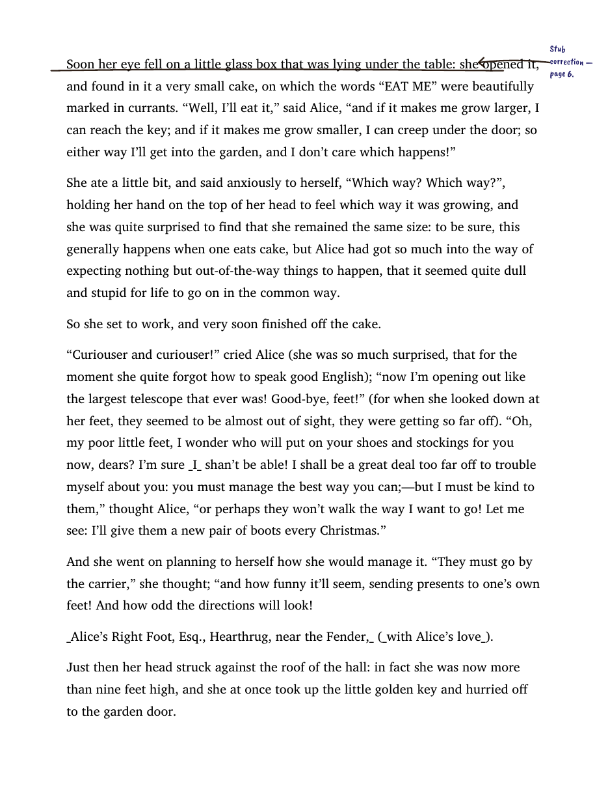

# Half-Blood Prince

*"This book is the property of the Half-Blood Prince."*

Turn any PDF or EPUB into a book someone brilliant, impatient, and a little bit dangerous has already annotated.

## What it does

Half-Blood Prince takes a PDF or EPUB and hands it to an LLM, page by page or spine item by spine item, in the voice of a specific persona — by default, a young Severus Snape scribbling corrections into his Potions textbook. The result is a new PDF or EPUB with handwritten-style annotations: corrections, shortcuts, warnings, and the occasional invented spell, rendered in ink color and connected to the exact passage they're reacting to.

It's the "Advanced Potion-Making" gag from *Harry Potter and the Half-Blood Prince*, generalized: any textbook, novel, or manual can get its own Prince in the margins — yours doesn't have to be a genius at potions, it can be a sardonic chemistry professor, a blunt line cook, or an impatient physicist.

## Quick demo

```bash
export ANTHROPIC_API_KEY=sk-ant-...

# Annotate a whole book
halfblood annotate potions_textbook.pdf -o annotated.pdf

# Preview just the first few pages without writing a PDF
halfblood preview potions_textbook.pdf --pages 1-3

# EPUB input is supported too
halfblood annotate book.epub -o annotated.epub

# Use a custom persona
halfblood annotate cookbook.pdf -o annotated.pdf \
  --persona "A blunt, classically trained cook who thinks most recipe writers have never cooked the dish they're describing."
```

`annotate` produces a PDF that looks like someone read the book with a pen in hand:

- A slightly rotated, handwritten-style note in the margin next to the passage it reacts to, in dark iron-gall-blue or rust-red ink depending on the kind of note (a warning reads redder and bolder than a dry aside).
- The target passage itself marked with hand-drawn vector ink — underlined for a correction, circled for an insight, highlighted for a warning, or struck through and replaced for something flat-out wrong. (Verified on a real render: the shipped `render_plan` path emits 230 vector drawings and 0 native PDF annotation objects. `_mark_target`'s native-annotation calls belong to the older `render_annotations` path, which the CLI no longer reaches.)
- A small hand-drawn connector arrow linking the note to the marked passage when it sits in the margin.
- Notes that vary in confidence: a certain aside is bold and opaque, a speculative one is fainter, as if dashed off less certainly.

## Committed example output

`examples/` contains real output produced by this tree, end to end:



| Artifact | What it is |
| --- | --- |
| `examples/hbp-example.pdf` | 78-page annotated PDF of *Alice's Adventures in Wonderland* (Project Gutenberg ebook #11), one annotation per page |
| `examples/hbp-example.pdf.report.json` | its failure sidecar: `pages_annotated: 78`, `failed_pages: []` |
| `examples/hbp-example.epub` | the EPUB twin, annotated (12/13 pages; page 1 is a near-blank cover, reported as `skipped`) |
| `examples/hbp-example.epub.report.json` | its failure sidecar |
| `examples/screenshot.png` | page 6 of the annotated PDF |
| `examples/src/` | the unannotated source book (typeset from Gutenberg text + the Gutenberg EPUB) |

**Honesty note:** these examples were rendered with the built-in deterministic
stub provider (`--provider stub`), so the note text is fixed ("Stub
correction — page N") — they demonstrate the *pipeline* (text anchoring,
collision-aware margin layout, hand-drawn ink rendering, sidecar reporting),
not model quality. Regenerate them yourself:

```bash
python scripts/build_example_book.py   # rebuilds examples/src/ from Project Gutenberg
halfblood annotate examples/src/alice.pdf  -o examples/hbp-example.pdf  --provider stub --force
halfblood annotate examples/src/alice.epub -o examples/hbp-example.epub --provider stub --force
```

## Crash safety: checkpoints, resume, and the failure sidecar

Every `annotate` run streams a checkpoint to `<output>.plan.json` after each
page completes, and writes a failure sidecar to `<output>.report.json` on
every exit — success, failure, or total failure:

```bash
# A run that fails on pages 1-5 (offline stub provider, no API key needed):
halfblood annotate book.pdf -o out.pdf --provider stub --fail-pages 1,2,3,4,5
# -> exits 1, NO out.pdf, but out.pdf.report.json names the failed pages
#    and out.plan.json holds the finished pages.

# Resume: retry only what failed, keep what already succeeded:
halfblood annotate book.pdf -o out.pdf --provider stub --resume-from out.plan.json --force
# -> exit 0; out.pdf.report.json shows resumed pages + newly generated ones.
```

The sidecar is machine-readable: `pages_total`, `pages_attempted`,
`pages_annotated`, `failed_pages`, `skipped_pages`, and per-page statuses.
A run that dies mid-book never costs you the pages it already finished.

## Installation

```bash
git clone <this repo>
cd half-blood-prince
pip install -e .

# for running tests
pip install -e ".[dev]"

# for the eval harness
pip install -e ".[eval]"

# reproducible dev environment (exact pinned versions used in CI/testing)
pip install -r requirements-dev.lock && pip install -e . --no-deps
```

`requirements-dev.lock` is the checked-in pin set; regenerate it after an
intentional dependency change with `pip freeze --exclude-editable`.

### Font setup (optional but recommended)

Annotations render in a handwriting font, and **four are bundled inside the package** —
Caveat Brush (the default), Homemade Apple, Just Me Again Down Here, and Mrs Saint
Delafield — under the OFL/Apache-2.0 licences shipped alongside them. Nothing to download.

Pick one by its registry key — `--font caveat-brush`, `homemade-apple`,
`just-me-again-down-here`, or `mrs-saint-delafield` (or the `font` config key) — or point
`--font` at any TTF/OTF path of your own. The keys are hyphenated slugs, not display names:
`--font "Caveat Brush"` is rejected.

To override the bundled default without passing a flag, drop a file at
`fonts/CaveatBrush-Regular.ttf` in the project root — a project-root font wins over the
bundled one. The resolver also auto-discovers any `*aveat*` TTF/TTC variant in that
directory, so any Caveat-family file works without configuration. Failing all of that it
tries common system font locations, and finally falls back to `Helvetica-Oblique` — the
pipeline still runs, just less magical-looking. See `fonts/README.md` for details.

Fonts resolve through `importlib.resources`, so they work identically from a source checkout
and from a pip-installed wheel. That distinction was once a real bug: `--font <name>` resolved
via repo-relative path arithmetic and failed in every installed wheel, telling users to
download a font that ships inside the package. `scripts/wheel_smoke.py` now guards it.

### Provider and API key

Half-Blood Prince calls an LLM to write the annotations. It talks to providers directly over
`httpx` through a thin seam (`src/halfblood/generation/providers/`) — **no vendor SDK is a
dependency of this project at all**, for generation or for the eval judge.

Five providers are supported: `anthropic` (default), `openai`, `openrouter`, `ollama`, and
`lmstudio`. The default needs an Anthropic key:

```bash
export ANTHROPIC_API_KEY=sk-ant-...
```

Any OpenAI-compatible endpoint works too, including local models that need no key at all:

```bash
halfblood annotate book.pdf -o annotated.pdf --provider ollama --model llama3
```

`halfblood providers doctor --offline` prints the resolved configuration (with the key
redacted) without making a network call.

## Usage

### `halfblood annotate`

Generate a fully annotated PDF or EPUB. `INPUT_FILE` may end in `.pdf` or `.epub`.

```bash
halfblood annotate INPUT_FILE -o OUTPUT_FILE [OPTIONS]

Options:
  -o, --output PATH      Path to write the annotated PDF or EPUB. [required]
  --persona TEXT         Annotator personality description.
  --pages TEXT           Page range, e.g. '1-5,8'. Default: all pages.
  --model TEXT           Model to use. [default: claude-sonnet-5]
  --max-per-page INT     Max annotations kept per page. [default: 5]
  --force                Overwrite an existing output file.
```

For safety, `annotate` and `web-preview` refuse to replace an existing output
file unless you pass `--force`. Missing output parent directories are created
automatically.

```bash
halfblood annotate advanced_potion_making.pdf -o annotated.pdf --pages 1-40
```

### `halfblood preview`

Generate annotations and print them as a table — no file written. Useful for iterating on a persona quickly. `INPUT_FILE` may be a `.pdf` or `.epub`.

```bash
halfblood preview INPUT_FILE [OPTIONS]

Options:
  --pages TEXT           Page range to preview. [default: 1-3]
  --persona TEXT         Annotator personality description.
  --model TEXT           Model to use.
  --max-per-page INT     Max annotations kept per page. [default: 5]
```

```bash
halfblood preview textbook.pdf --pages 12-14 --persona "an impatient theoretical physicist"
```

### `halfblood web-preview`

Render an annotation plan JSON file as one self-contained, offline HTML viewer.

```bash
halfblood web-preview annotated_plan.json -o preview.html
```

### `halfblood eval`

Run the annotation-quality evaluation harness (see [Evaluation](#evaluation) below).

```bash
halfblood eval [OPTIONS]

Options:
  --model TEXT       Override the generator model for the eval harness.
  --json-out PATH    Write raw evaluation results as JSON.
  --list             List test cases and exit without calling the API.
```

```bash
halfblood eval --list
halfblood eval --model claude-opus-4-1-20250805 --json-out results.json
```

## Custom Personas

The "Prince" is just a system-prompt persona string — swap it out and you get an entirely different annotator personality while reusing all the generation, parsing, and rendering plumbing. Pass one with `--persona` on the CLI, or construct an `AnnotationGenerator(persona=...)` directly in Python:

```python
from halfblood.annotation_generator import AnnotationGenerator

generator = AnnotationGenerator(
    persona=(
        "A no-nonsense debate coach who has watched a thousand mediocre "
        "arguments collapse under the first hard question. Terse, "
        "impatient, allergic to hand-waving."
    )
)
```

The legacy `AnnotationGenerator(api_key=...)` keyword remains available for one minor
release but is deprecated. Build an `LLMProvider` and pass it with `provider=` instead;
the `api_key=` compatibility path will be removed in the next minor release.

A good persona description covers:

- **Domain expertise** — what they're actually an expert in, so annotations stay specific and plausible rather than generic.
- **Voice and temperament** — terse vs. verbose, sardonic vs. earnest, how they react to sloppiness.
- **What "counts" as worth annotating** — a good persona is selective, not a highlighter over every sentence.

See `DEFAULT_PERSONA` in `src/halfblood/annotation_generator.py` for the full Snape persona as a worked example, and `eval/eval_harness.py`'s `TEST_CASES` for five more (chemist, cook, philosopher, physicist, debate coach).

## Architecture

```
PDF in  --> DocumentProcessor.load()        (extract: PDF -> per-page plain text)
EPUB in --> EpubProcessor.load()            (extract: spine XHTML -> per-item plain text)
       --> AnnotationGenerator.generate_for_document()
                                            (generate: text -> AnnotationPlan via provider structured output)
       --> DocumentProcessor/EpubProcessor.render_plan()
                                            (render: AnnotationPlan -> annotated PDF or EPUB out)
```

- **`models/`** — the shared Pydantic vocabulary (`Annotation`, `AnnotatedPage`, `AnnotationPlan`, `AnnotationType`, plus the v2 rendering models) that every other module speaks. It is a package, not a single `models.py`.
- **`document_processor.py`** — everything that touches PDF bytes: text extraction (PyMuPDF), locating target passages on the page, and drawing the handwritten margin notes back on.
- **`annotation_generator.py`** — everything that talks to the model: persona/system prompt construction, per-page and whole-document generation, structured output, and response validation. Transport itself lives behind `generation/providers/`.
- **`epub_processor.py`** — EPUB extraction and XHTML/CSS annotation rendering, with the same load/render interface as the PDF processor.
- **`web_preview.py`** — renders an annotation plan into one self-contained offline HTML viewer.
- **`cli.py`** — the `halfblood` command (`annotate`, `preview`, `web-preview`, `eval`), wiring the processors and generator together with a Rich progress UI.
- **`eval/eval_harness.py`** — standalone LLM-as-judge quality evaluation, runnable independently of the CLI.

See `docs/ARCHITECTURE.md` for the full technical write-up.

## Evaluation

`eval/eval_harness.py` exercises the real annotation pipeline against five curated passages (chemistry, cooking, philosophy, physics, rhetoric) and grades the output with Claude as a judge across five metrics: **voice consistency**, **relevance**, **insight depth**, **variety**, and **density**. Each metric has a 1-5 rubric and a pass/fail threshold.

```bash
export ANTHROPIC_API_KEY=sk-ant-...

# via the CLI
halfblood eval --model claude-opus-4-1-20250805

# or standalone (no install required)
python eval/eval_harness.py --judge-model claude-opus-4-1-20250805
python eval/eval_harness.py --judge-model claude-opus-4-1-20250805 --json-out results.json
python eval/eval_harness.py --list
```

Generator and judge configuration resolve independently. By default they resolve to the
same Anthropic preset and the harness exits with an error; choose a distinct generator with
`--provider`/`--model` or a distinct judge with `--judge-provider`/`--judge-model`.
`--allow-self-judge` permits identical settings for development only. The judge runs over the
same httpx provider seam as generation, so no vendor SDK is involved on either path.

`HALFBLOOD_EVAL_MODEL` is deprecated but remains supported for one minor release as a
generator-only model setting. An explicit `--model` takes precedence, and the variable never
configures the judge.

The harness prints a per-test-case table of scores and justifications, then a summary table and an overall grade. Exit code is `0` only if every test case passes every metric's threshold — wire it into CI to catch persona or prompt regressions.

## Contributing

**Adding a new annotation type**

1. Add the value to `AnnotationType` in `models/annotations.py`.
2. Give it an ink color in `_INK_PALETTE` and a font size in `_FONT_SIZE_BY_TYPE` in `document_processor.py`.
3. Decide how it should mark the target passage in `DocumentProcessor._mark_target` (underline / highlight / circle / strikeout).
4. Describe it in `DEFAULT_PERSONA`'s "WHAT YOUR ANNOTATIONS DO" list (and in any custom personas you maintain) so the model actually knows when to use it.

**The shipping EPUB pipeline**

`EpubProcessor` already implements the same `load` / `render_annotations` boundary as `DocumentProcessor`: it reads spine items into `PageContent` and writes annotations back into EPUB XHTML/CSS. `AnnotationGenerator` only ever sees `PageContent` (page number, text, width, height), so a future format can follow that established interface while supplying rendering appropriate to its layout model.

**Adding eval test cases**

Append a `TestCase` to `TEST_CASES` in `eval/eval_harness.py` with a persona, a passage, expected annotation types, and an ideal annotation-count range — the harness picks it up automatically.

## License

Half-Blood Prince is licensed under the **GNU Affero General Public License v3.0 or later**
(see [`LICENSE`](LICENSE)).

AGPL is required rather than chosen. Two load-bearing runtime dependencies are themselves
AGPL-licensed, so any distribution of this project is a combined work bound by AGPL terms:

| Dependency | License | Why it can't be swapped |
| --- | --- | --- |
| **PyMuPDF** (`fitz`) | AGPL-3.0 **or** Artifex Commercial | Uniquely provides text search, native PDF annotation objects, and affine-morphed `Shape` text in one document model |
| **EbookLib** | AGPL-3.0-or-later (no commercial option) | Owns the EPUB read/spine/manifest/write pipeline |

Two consequences worth knowing before you deploy:

- **Network use triggers AGPL §13.** If you offer this program's functionality to users over a
  network, you must make the Corresponding Source available to those users.
- **A commercial PyMuPDF license is not an escape hatch**, because EbookLib is AGPL-only.

The reasoning behind every dependency is recorded in
[`docs/decisions/tech-stack-validation.md`](docs/decisions/tech-stack-validation.md).

### Bundled fonts

The handwriting fonts in `src/halfblood/fonts/` are licensed separately from the source code:
Caveat Brush, Just Me Again Down Here, and Mrs Saint Delafield under the
[SIL Open Font License 1.1](src/halfblood/fonts/OFL.txt); Homemade Apple under the
[Apache License 2.0](src/halfblood/fonts/Apache-2.0.txt).

## Inspiration

This project is a riff on [Riddle](https://github.com/MaximeRivest/riddle) and the "Half-Blood Prince" gag from *Harry Potter and the Half-Blood Prince* — a used Potions textbook whose margins are full of a previous, better student's corrections, shortcuts, and dangerous inventions. Half-Blood Prince asks: what if any book could have its own Prince?
