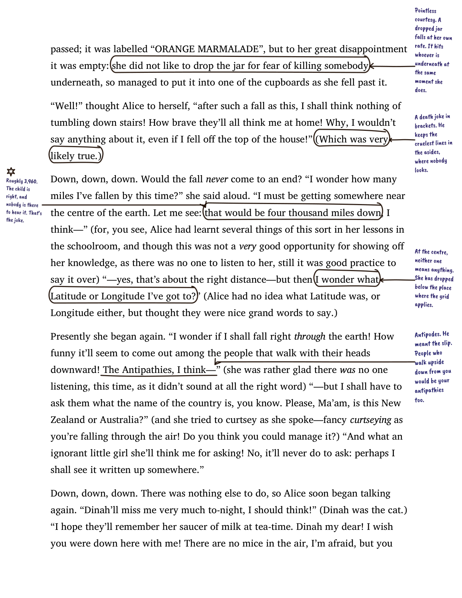
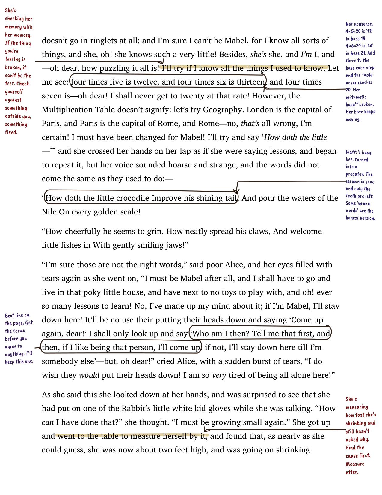
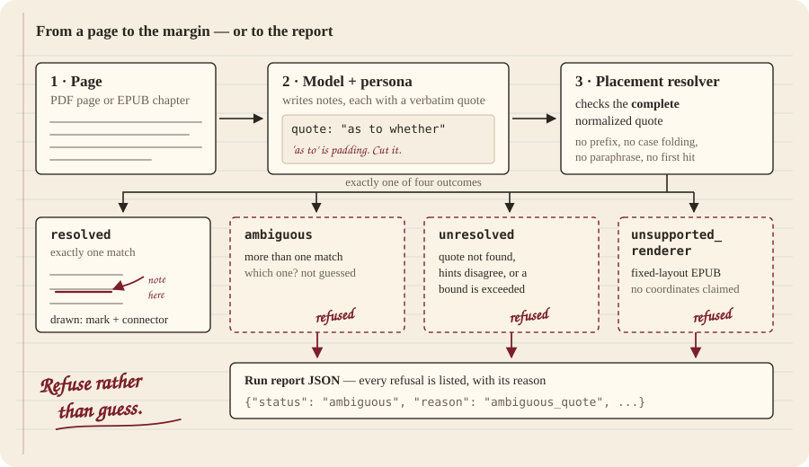

# Half-Blood Prince

Quoted evidence, placed on a document — or an explicit refusal.

Half-Blood Prince is a Python toolkit and CLI for PDF and EPUB
annotations. Its deterministic placement interface separates **finding a
quoted passage** from **generating a useful note** from **drawing a
readable annotation**. Those are three different checks. A resolved
quote does not prove that an LLM's comment is correct.

## What it does

<p align="center">
  
  
</p>

Give it a PDF or EPUB and a persona. A model writes margin notes, each
quoting the passage it reacts to. A note is drawn only when its complete
quote resolves to one place in the text; every refusal is listed in the
run report.

The pages above are from a real-model run on public-domain *Alice*
(PDF pages 1–12: 60 notes generated, 60 placed, 0 refused), generated
through the Claude Code CLI (`--provider claude-cli`, CLI alias `opus`)
on 2026-10-23. One note from a run on 2026-10-22, on the single
82,383-character chapter of *The Elements of Style* (35 generated, 35
placed):

> **yours, and oneself have no apostrophe**
>
> *'Oneself' is reflexive, not possessive. The possessive is 'one's',
> and it HAS an apostrophe. Wrong word, wrong rule.*

That is a real error in the 1918 text. These notes have **not been
independently judged** (gate G5 is open); the review in
[`examples/real/NOTES-REVIEW.md`](examples/real/NOTES-REVIEW.md) is the
generating agent's own reading against the source, including the notes
it found wrong. Plans, run reports, and the annotated PDF and EPUB are
in [`examples/real/`](examples/real/).

<p align="center">
  
</p>

Long reflowable chapters are generated in windows of at most 12,000
characters, so a long chapter is annotated throughout rather than
getting a handful of notes for the whole chapter.

## Evidence-to-placement contract

`halfblood.placement` accepts a quote and optional context or offsets.
It returns one of four outcomes:

| Outcome | Meaning |
| --- | --- |
| `resolved` | One complete normalized quote satisfies the supplied hints; renderer-specific evidence is available. |
| `ambiguous` | More than one eligible match remains. No placement geometry is returned. |
| `unresolved` | The quote or hints cannot be verified, geometry is unavailable, or an input bound is exceeded. |
| `unsupported_renderer` | The requested renderer cannot supply this placement contract. |

Matching normalizes NFC, whitespace, typographic quote marks, and dashes.
It does **not** recover paraphrases, ignore case, drop arbitrary
punctuation, or shorten a quote to a convenient prefix. Supplied context
and offsets must agree with the match; they are not proximity hints.

- **PDF:** resolved quads use `pdf_display_points`, with the page's
  display transformation applied. They describe the extracted text
  layer, not OCR truth or a guarantee about every source PDF.
- **Reflowable EPUB:** resolved spans use `epub_dom_text`. They identify
  text nodes and offsets, not stable screen pixels. Layout changes with
  the reading system.
- **Fixed-layout EPUB:** coordinate placement is **not shipped**. It
  returns `unsupported_renderer`; PDF coordinates are not reused as EPUB
  coordinates.

The full contract — schemas, bounds, reason codes, the difference
between resolution and rendering, and what is explicitly **out of scope**
— lives in [`docs/placement-contract.md`](docs/placement-contract.md).

## Refusal policy

**Fail-closed anchoring** is this project's vocabulary for its refusal policy,
not a recognized standard. The established selector names are W3C
`TextQuoteSelector` and `TextPositionSelector`; Hypothesis documents fuzzy
anchoring. These are cited under [Related work](#related-work).

## Run the evidence check

From a checkout, with Python 3.11+:

```bash
uv venv
uv pip install --python .venv/bin/python -e ".[dev]"
.venv/bin/python -c "import halfblood; print(halfblood.__file__)"

.venv/bin/python scripts/benchmark_placement.py
.venv/bin/python -m pytest tests/ -q
```

The placement benchmark uses a checked-in oracle corpus that includes a
short *Alice's Adventures in Wonderland* excerpt in PDF and EPUB plus
adversarial refusal cases. It reads glyphs from `page.get_text("rawdict")`
directly and rebuilds EPUB segments from `bs4.Tag.descendants`
independently of `halfblood.placement`; expected values are not a
self-oracle. It emits JSON to stdout and exits nonzero on a mismatch. It
needs no network, API key, or model.

[`tests/test_placement_benchmark.py`](tests/test_placement_benchmark.py)
runs the same corpus under pytest with a set of `red_capable_mutations`
that wrap the resolver, corrupt one field of the returned record each,
and assert the benchmark detects those injected failures. The
corpus, the mutations, and the expected values are all checked in; the
benchmark does not exercise LLM quality, connector routing, complete-book
accuracy, or visual similarity between EPUB readers.

See [`docs/readme-claims.md`](docs/readme-claims.md) for evidence
labels, checks, source permissions, and the limits of each claim in
this README.

## Try the annotation pipeline offline

The committed [`examples/`](examples/) directory ships
`examples/hbp-example.pdf`, `examples/hbp-example.pdf.report.json`,
`examples/hbp-example.epub`, `examples/hbp-example.epub.report.json`,
`examples/screenshot.png`, and the unannotated `examples/src/`
fixture. Both sidecars record the runs that produced them. They are
**stub-provider demonstrations** with fixed "Stub correction — page N"
notes; the PDF source is newly typeset text, the EPUB source is
reflowable, and regeneration can change output bytes and reports as
dependencies and rendering code change. They are not a model-quality
sample and not pinned to a specific historical render.

```bash
# Use the committed sources below; no download is needed.
.venv/bin/halfblood annotate examples/src/alice.pdf  -o examples/hbp-example.pdf  --provider stub --force
.venv/bin/halfblood annotate examples/src/alice.epub -o examples/hbp-example.epub --provider stub --force
.venv/bin/halfblood annotate examples/src/alice.pdf  -o /tmp/hbp-plan.json --provider stub --pages 1-3 --dry-run --force
# Only after an interrupted run left this checkpoint:
.venv/bin/halfblood annotate examples/src/alice.pdf  -o /tmp/hbp-demo.pdf --provider stub --resume-from /tmp/hbp-demo.pdf.plan.json --force
.venv/bin/halfblood annotate examples/src/alice.pdf  -o /tmp/hbp-demo.pdf --provider stub --fail-pages 1,2 --force
.venv/bin/halfblood web-preview /tmp/hbp-plan.json -o /tmp/hbp-demo.html --force
```

`--fail-pages` is a **test knob**: when some pages succeed the
artifact still ships and the sidecar lists the failed page numbers;
when every page fails the artifact is not written, the sidecar lists
every page as failed, and the run exits nonzero. Read
`<output>.report.json`, not just the command's exit status — it
separates generated pages, rendered notes, skips, mark-only output,
placement outcomes, and composition degradations, which are not
interchangeable coverage measures.

To rebuild the example inputs from Project Gutenberg (network required), run
`.venv/bin/python scripts/build_example_book.py`. The commands above regenerate
the annotated examples, not byte-identical historical artifacts.

For real generation, configure a supported provider and your own
credentials. The default model is `claude-sonnet-5`. The `anthropic`
provider reads `ANTHROPIC_API_KEY`. Other configured providers are
`openai`, `openrouter`, `ollama`, `lmstudio`, `openai-compatible`,
`claude-cli`, and `stub`; endpoint and model compatibility still need
checking. `claude-cli` runs a locally installed, signed-in Claude Code
CLI headless (default alias `opus`), so a Claude subscription can
generate without an API key; it is how `examples/real/` was made.
Real generation can cost money. **No paid model-quality evaluation is
presented as evidence for this release.**

## Usage reference

`INPUT_FILE` is a `.pdf` or `.epub`. The CLI refuses to overwrite an
existing output file unless `--force` is passed, and creates the
output parent directory if it is missing. It refuses input aliases even
with `--force`, including checkpoint and report paths. Supplied resume
files are kept unchanged. Built-in persona names with
`--persona-name` are `chemist`, `detective`, `editor`, `philosopher`.

Four handwriting fonts are bundled inside the package under SIL
OFL 1.1 / Apache 2.0 (see [`fonts/README.md`](fonts/README.md)). Pick
one with `--font caveat-brush` (display names like `"Caveat Brush"`
are rejected). The resolver walks `<project>/fonts/CaveatBrush-Regular.ttf`,
then any `<project>/fonts/*aveat*.tt[fc]` glob, then the bundled
`importlib.resources` files, then common system locations, then
`Helvetica-Oblique`.

For reproducible CI / test versions, install from the checked-in lock
file before the package itself (with pip in an activated project venv):

```bash
pip install -r requirements-dev.lock && pip install -e . --no-deps
```

Regenerate `requirements-dev.lock` after an intentional dependency
change with `pip freeze --exclude-editable`. The full pyproject upper
bounds are intentional and live in `pyproject.toml`.

## Boundaries

`render_plan()` is the CLI's live entry point. The CLI does not call
the legacy `render_annotations` method.

- Scanned PDFs need an existing text layer. This project does not
  perform OCR.
- Quote verification does not validate a model's reasoning, expertise,
  or persona.
- Margin placement and connector routing are separate from quote
  resolution. Crowded pages can cause skips, mark-only output, or
  degraded connectors.
- PDF notes use bundled handwriting fonts, not generated penmanship.
  Procedural note-body handwriting is not available.
- EPUB reader layout and font support vary. A DOM anchor is not a
  coordinate renderer, and fixed-layout EPUB is not silently treated as
  reflowable.
- Legacy compatibility methods and matching helpers, including
  `render_annotations`, `score_candidates`, and `locate_across_nodes`, are
  explicitly **outside** this contract. The supported `render_plan` path
  does not use their prefix recovery.

## Related work

This project does not claim to invent quote anchoring or PDF text
alignment.

- W3C defines
  [TextQuoteSelector](https://www.w3.org/TR/annotation-model/#text-quote-selector)
  (`exact`, `prefix`, `suffix`) and
  [TextPositionSelector](https://www.w3.org/TR/annotation-model/#text-position-selector).
- [Anchorite](https://github.com/populationgenomics/anchorite) already
  connects PDF quotes to bounding boxes. It uses Smith–Waterman matching,
  uniqueness checks during alignment, and rejection gates for inadequate
  matches. This project does not claim that quote-to-bbox or rejection is
  new. Its combination is PDF placement, cross-node EPUB text ranges, and
  collision-aware note layout.
- [Hypothesis](https://web.hypothes.is/blog/fuzzy-anchoring/) documents
  fuzzy anchoring. Approximate matching is prior art, not a capability
  claimed by this strict whole-quote interface.

[Riddle](https://github.com/MaximeRivest/riddle) and the
"Half-Blood Prince" story inspired the persona-and-marginalia demo.

## License and example sources

The code is [AGPL-3.0-or-later](LICENSE). PyMuPDF offers
AGPL/commercial licensing; EbookLib is AGPL-licensed. Review their
terms for your use and distribution. Bundled fonts have separate
OFL/Apache-2.0 terms in
[`THIRD_PARTY_NOTICES.md`](THIRD_PARTY_NOTICES.md).

The examples derive from Lewis Carroll's *Alice's Adventures in
Wonderland*, [Project Gutenberg ebook #11](https://www.gutenberg.org/ebooks/11),
listed as **public domain in the USA**. The typeset and annotated
outputs are modified pipeline demonstrations. The cached text and EPUB
include Gutenberg terms; see
[its full license](https://www.gutenberg.org/policy/license.html).

> This eBook is for the use of anyone anywhere in the United States
> and most other parts of the world at no cost and with almost no
> restrictions whatsoever. You may copy it, give it away or re-use it
> under the terms of the Project Gutenberg™ License included with this
> eBook or online at www.gutenberg.org. If you are not located in the
> United States, you will have to check the laws of the country where
> you are located before using this eBook.
